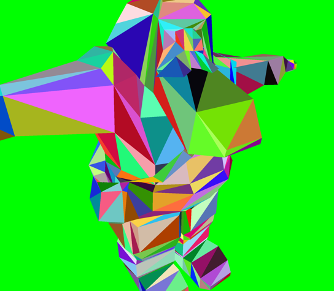
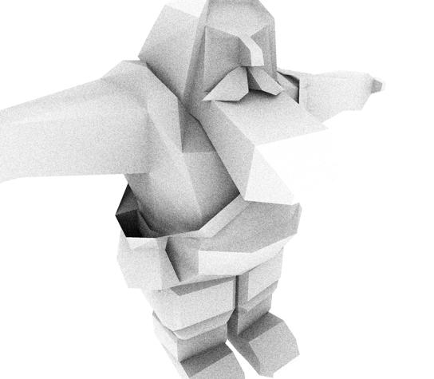
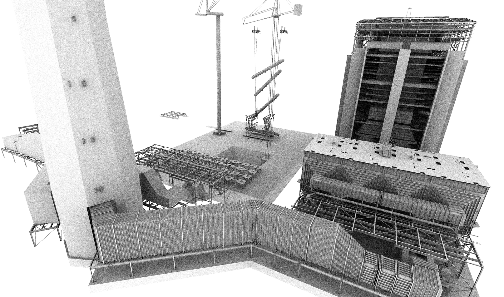

В этом репозитории предложены задания для курса по вычислениям на видеокартах 2026.

[Остальные задания](https://github.com/GPGPUCourse/GPGPUTasks2026/).

# Задание 8. Real-time построение Linear BVH (LBVH) для трассировки лучей

[](https://github.com/GPGPUCourse/GPGPUTasks2026/actions/workflows/cmake.yml)

В этом задании вам предлагается выбрать API (OpenCL, CUDA или Vulkan) реализовать на GPU алгоритм построения LBVH для ускорения трассировки лучей.

Благодаря трассировке лучей мы отрендерим два frame buffer:

1) Frame buffer с номером треугольника в каждом пикселе (удобно для тестирования и для [deffered rendering](https://learnopengl.com/Advanced-Lighting/Deferred-Shading))



2) Frame buffer с Ambient Occlusion показывающим как много внешнего прямого света попадает в эту точку поверхности, например у гнома внутри сумки поэтому темно, а на бороде - светло:



Статья которую мы обсуждали на лекции и идеям которой мы следуем: [Maximizing Parallelism in the Construction of BVHs, Octrees, and k-d Trees, Tero Karras, 2012](https://devblogs.nvidia.com/wp-content/uploads/2012/11/karras2012hpg_paper.pdf)

## Датасеты

 - [data/gnome](data/gnome) - простая модель гнома - 1.297 вершин, 764 треугольника, уже скачано в репозиторий
 - [data/powerplant](data/powerplant) - детальная модель угольной электростанции - 5.984.083 вершин, 12.759.246 треугольников, нужно скачать [с яндекс.диска](https://disk.yandex.ru/d/u4ORSCvWdITAkw) или [отсюда](https://casual-effects.com/g3d/data10/research/model/powerplant/powerplant.zip)
 - [data/san-miguel](data/san-miguel) - детальная модель местечка расположенного в поместье в Сан-Мигель-де-Альенде, Мексика - 5.933.233 вершин, 9.980.699 треугольников, нужно скачать [с яндекс.диска](https://disk.yandex.ru/d/mIP8q6V9nJiBLw) или [отсюда](https://casual-effects.com/g3d/data10/research/model/San_Miguel/San_Miguel.zip)

Смотрите какая красота! Это отрисованный frame buffer с ambient occlusion для powerplant:



## Структура исходников проекта в папке

 - ```cpu_helpers/build_bvh_cpu.h``` - эталонная однопоточная CPU-реализация построения LBVH
 - ```cpu_helpers/morton_code_cpu.h``` - вспомогательная функция для построения 30-битного 3D кода Мортона для точки из единичного куба
 - ```debug/debug_bvh.h``` - не используется, использовалось для визуализации построенного BVH для отладки
 - ```debug/debug_geometry.h``` - не используется, использовалось для отладки корректности считанной геометрии (через сохранение вершин и треугольников в .ply файл)
 - ```io/camera_reader.h``` - позволяет считать ```CameraViewGPU``` из файла camera.txt - это ракурс который мы хотим отрисовать для каждой сцены, для эксперимента (но не коммитьте это) можете выбрать другой ракурс - для этого откройте модель в [MeshLab](https://www.meshlab.net/), расположите камеру как вам нравится, нажмите ```Ctrl+C```, затем откройте ```camera.txt``` файл и нажмите ```Ctrl+V```
 - ```io/scene_reader.h``` - позволяет считать ```SceneGeometry``` - геометрию датасета (множество 3D точек и треугольников на них покоящихся) из ```.ply```/```.obj```-файла
 - ```kernels/shared_structs/..._gpu_shared.h``` - ```CameraViewGPU```, ```BVHNodeGPU```, ```AABBGPU```, ```MortonCode``` - это аккуратно сделанные структуры в которых нет сложных типов вроде ```point3f```/```bool```/```unsigned short``` которые на разных API могут привести к разной выкладке (layout) объектов этой структуры (разный padding, разный alignment, разный fabric), благодаря этому есть шанс что объект на CPU выглядит так же как выглядит на GPU в OpenCL/CUDA/Vulkan (GLSL) кернелах

## Что уже реализовано

1) Уже сделано построение LBVH на CPU
2) Уже сделана трассировка лучей на GPU с перебором всех треугольников (т.е. brute force), она запускается только для маленького датасета ```data/gnome```

## Что вам предлагается сделать

1) ```5 баллов``` Реализуйте трассировку лучей на GPU используя LBVH - то есть вам нужно реализовать обход BVH иерархии (без рекурсии)
2) ```10 баллов``` Постройте LBVH на GPU, если вы задаетесь вопросом - а как строить AABB - поищите подсказку в [оригинальной статье](https://devblogs.nvidia.com/wp-content/uploads/2012/11/karras2012hpg_paper.pdf), давайте для сортировки договоримся что можно использовать любой код - в т.ч. чужой (но это обсуждаемо - пишите в чате, до 21 ноября 23:59 это правило может меняться - см. явный анонс в чате)
3) Оттрасируйте лучи на GPU используя построенный на GPU LBVH
4) Дополнительные ```5 баллов престижа``` если вы сделаете **denoising**. Подумайте - вероятно это не такая сложная задача, ведь ее можно делать на основании результатов отрисованных **framebuffers**. Например если у вас есть в каждом пикселе экрана вектор нормали к поверхности и т.п.. В таком случае в PR должны быть приложены картинки Ambient Occlusion в двух экземплярах на каждый датасет - до и после удаления шума.
5) Дополнительные ```10 баллов престижа``` если вы добавите hardware-accelerated Ray Tracing (использующий RT cores).

Итого можно получить ```15 баллов``` + ```15 баллов престижа``` + **ПРИЗОВЫЕ**.

При отправке PR достаточно приложить ваш локальный вывод. И если вы сделали **denoising** - 6 картинок - пара картинок до/после для каждой сцены. Если вы проявили любопытство и сделали что-то еще - расскажите об этом (вероятно тоже с картинками).

**Дедлайн**: 23:59 28 ноября (**суббота**).
