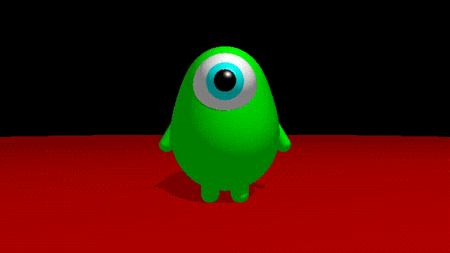

В этом репозитории предложены задания для курса по вычислениям на видеокартах 2026.

[Остальные задания](https://github.com/GPGPUCourse/GPGPUTasks2026/).

# Задание 9. SDF



1. Откройте страницу [Shadertoy](https://www.shadertoy.com/new).
2. Скопируйте заготовку, предоставленную в файле ```src/sdf_main.glsl``` в блок с кодом, скомпилируйте, проверьте что появилась простая сцена со сферой и плоскостью
3. Реализуйте пропущенные ```TODO``` блоки кода, чтобы получить изображение монстрика похожего на пример выше
4. Если чувствуется вдохновение, то можно добавить какие-то дополнительные элементы, например, научить монстрика моргать, добавить ему пасть, зубки, сделать более интересный задний фон и тд.
5. Как источник всяких технических улучшений и вдохновения супер удобно использовать сайт [Inigo Quilez](https://iquilezles.org/articles/)

Pull request
============

0. Сделать fork проекта
1. Выполнить задание (см. выше)
2. В файле ```src/sdf_main.glsl``` должен быть ваш финальный код (в случае если у вас их несколько - создайте еще файлы рядом, например ```buffer_a.glsl``` и т.п.)
3. Отправить **Pull-request** с названием ```Task09 <Имя> <Фамилия> <Аффиляция>```
4. В PR должно быть вставлен **скриншот** (если анимация - то **видео**) с результатом

За задание можно получить ```7 баллов``` + **ПРИЗОВЫЕ** (на субъективный художественный вкус жюри).

**Дедлайн**: 23:59 30 ноября (понедельник).
