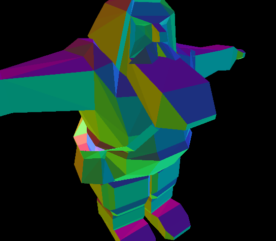
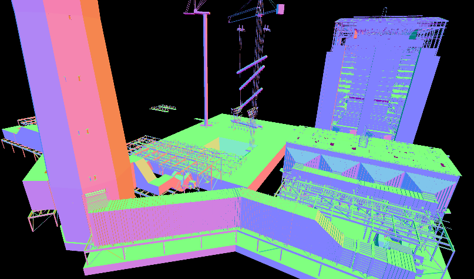

В этом репозитории предложены задания для курса по вычислениям на видеокартах 2026.

[Остальные задания](https://github.com/GPGPUCourse/GPGPUTasks2026/).

# Задание 10. Software (программная) растеризация на GPGPU (подобно [cudaraster](https://code.google.com/archive/p/cudaraster/))

[](https://github.com/GPGPUCourse/GPGPUTasks2026/actions/workflows/cmake.yml)

В этом задании вам предлагается выбрать API (OpenCL, CUDA или Vulkan) ускорить на GPU алгоритм растеризации - чтобы стало быстрее чем при тривиальной Брезенхем растеризации один workItem/thread на один треугольник + atomic CAS (для многопоточной конкуренции в depth-test framebuffer).

Игрушечный фрагментный шейдер отрисовывает нормали в цветовой форме:



Статья которую мы обсуждали на лекции и идеям которой мы следуем: [High-Performance Software Rasterization on GPUs, Samuli Laine and Tero Karras, 2011](https://research.nvidia.com/sites/default/files/pubs/2011-08_High-Performance-Software-Rasterization/laine2011hpg_paper.pdf)

## Датасеты

 - [data/gnome](data/gnome) - простая модель гнома - 1.297 вершин, 764 треугольника, уже скачано в репозиторий
 - [data/powerplant](data/powerplant) - детальная модель угольной электростанции - 5.984.083 вершин, 12.759.246 треугольников, нужно скачать [с яндекс.диска](https://disk.yandex.ru/d/u4ORSCvWdITAkw) или [отсюда](https://casual-effects.com/g3d/data10/research/model/powerplant/powerplant.zip)
 - [data/san-miguel](data/san-miguel) - детальная модель местечка расположенного в поместье в Сан-Мигель-де-Альенде, Мексика - 5.933.233 вершин, 9.980.699 треугольников, нужно скачать [с яндекс.диска](https://disk.yandex.ru/d/mIP8q6V9nJiBLw) или [отсюда](https://casual-effects.com/g3d/data10/research/model/San_Miguel/San_Miguel.zip)

Это отрисованный normals frame buffer для powerplant:



## Что уже реализовано

1) Уже реализован многопоточный Брезенхэм на CPU (OpenMP многопоточность с гранулярностью на уровне треугольников + atomic CAS) - ```src/kernels/cpu/sw_rasterize_normals.cpp```
2) Уже реализована hardware (аппаратная) растеризация на GPU через Vulkan API - ```src/kernels/vk/hw_rasterize_normals.vert``` + ```hw_rasterize_normals.frag```
3) Уже реализована software (программная) тривиальная растеризация на GPGPU - ```cu/sw_rasterize_normals.cu``` / ```cl/sw_rasterize_normals.cl``` / ```vk/sw_rasterize_normals.comp```

## Что вам предлагается сделать

```10 баллов``` Ускорьте software (аппаратную) растеризацию как можно сильнее чтобы приблизиться к hardware растеризации. Пример baseline отставания на RTX 4090:

```
Using device #1: API: CUDA+OpenCL+Vulkan. GPU. NVIDIA GeForce RTX 4090 (CUDA 13000). Free memory: 21304/24058 Mb.
[SW GPGPU] API for software GPGPU rasterization: CUDA
...
Total [CPU]       rasterization avg time: 110.072 ms (all 3 values: [15.8664 164.127 150.224])
Total [HW Vulkan] rasterization avg time: 0.941814 ms (all 3 values: [0.148251 1.4442 1.23299])
Total [SW GPGPU]  rasterization avg time: 12.3776 ms (all 3 values: [3.4139 9.04822 24.6708])
HW->SW slowdown: x13.1423
```

**Дедлайн**: 23:59 7 декабря.
 